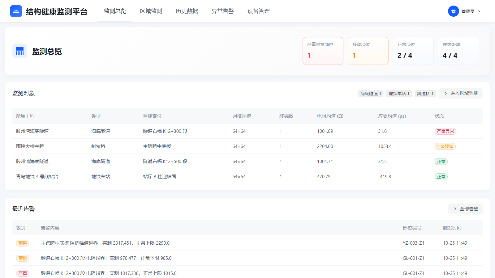
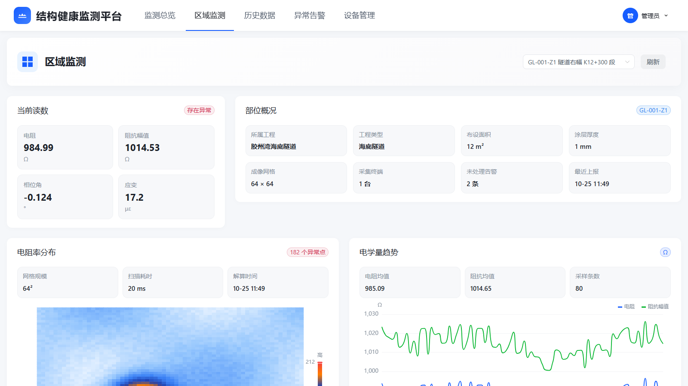
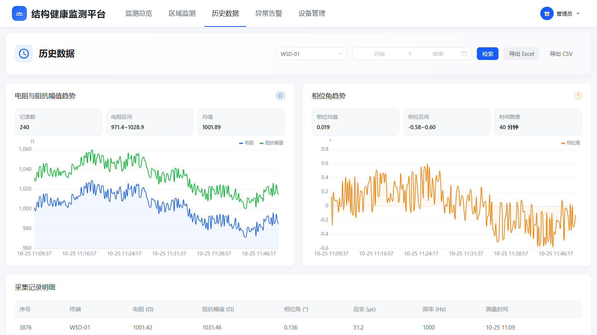
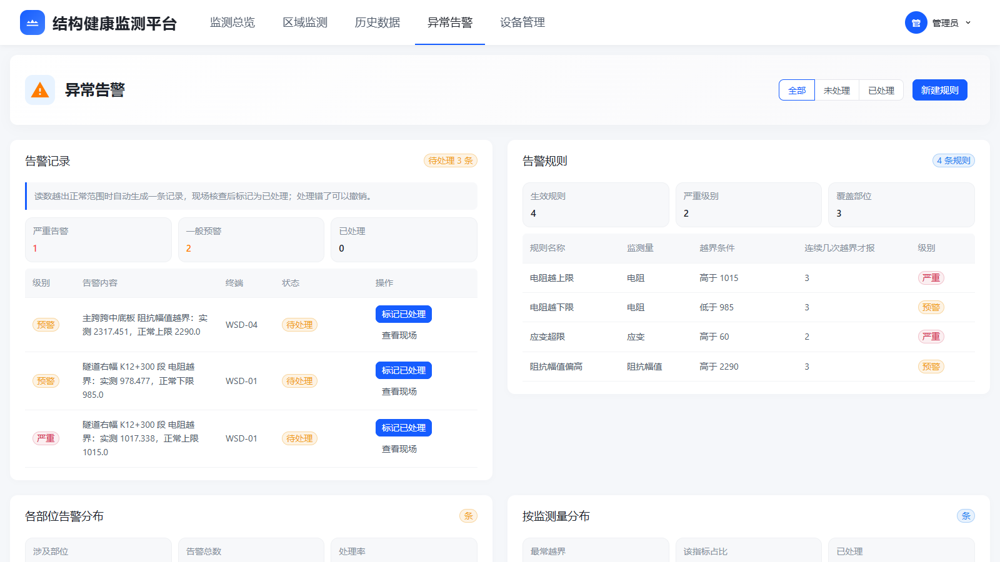
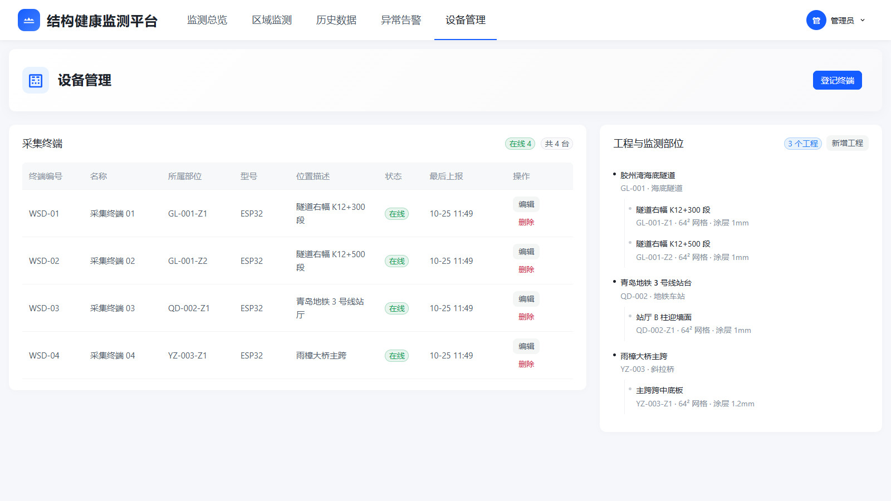

# 结构健康监测平台

面向工程结构健康监测的数据采集与可视化平台。测量终端通过 HTTP POST 把每次测量的电阻、相位角、阻抗幅值、频率四个量上报到平台，平台负责落库、告警比对与前端展示。

管理对象按三级组织：**工程结构 → 监测部位 → 采集终端**。



## 功能

- **监测总览** —— 各部位的异常分布、在线终端数、近期告警一屏看完
- **区域监测** —— 单个部位的当前读数、电阻率分布热力图、电学量趋势
- **历史数据** —— 按终端与时间区间查询，曲线与表格对照，支持导出 CSV / Excel
- **异常告警** —— 规则配置、告警确认、越界统计
- **设备管理** —— 结构与终端的增删改查，结构树展示归属关系



历史数据页可以按时间区间回看，并把查询结果导出成表格：



告警页列出越界记录，规则可以按监测量配置上下限与连续触发次数：



设备管理页用结构树呈现归属关系，终端的增删改查都在这里：



## 技术栈

| 层 | 选型 |
| --- | --- |
| 后端 | FastAPI + SQLAlchemy 2.0 + Pydantic v2 |
| 数据库 | PostgreSQL 14+ |
| 前端 | Vue 3 + Vite 6 + naive-ui + ECharts 5 + Axios |
| 鉴权 | JWT（HS256）+ bcrypt |

## 目录结构

```
.
├── backend/
│   ├── app/
│   │   ├── api/routes/      接口层，按业务分文件
│   │   ├── core/            配置
│   │   ├── db/              引擎与会话
│   │   ├── models/          ORM 模型
│   │   ├── schemas/         请求与响应校验
│   │   ├── services/        业务逻辑
│   │   └── main.py          应用入口
│   ├── scripts/             建库、灌演示数据、模拟终端等
│   ├── .env.example         配置模板
│   ├── requirements.txt
│   └── run.py               启动入口
├── frontend/
│   ├── src/
│   │   ├── api/             Axios 封装
│   │   ├── router/          路由与登录拦截
│   │   ├── utils/           图表配置
│   │   ├── views/           页面
│   │   └── style.css
│   ├── package.json
│   └── vite.config.js
└── assets/                 README 用图
```

## 本地运行

### 准备数据库

先确保 PostgreSQL 已启动，然后建库并灌入演示数据：

```bash
cd backend
pip install -r requirements.txt
cp .env.example .env        # Windows 用 copy .env.example .env
```

编辑 `.env`，把 `DATABASE_URL` 里的密码改成你自己的，管理员密码和密钥也一并改掉。

```bash
python scripts/create_database.py     # 建 resistance_db 库
python scripts/init_demo_data.py      # 灌演示数据
```

### 启动后端

```bash
cd backend
python run.py
```

服务起在 `http://127.0.0.1:8002`，接口文档在 `/docs`。首次启动会自动建表并创建管理员账号（账号密码取 `.env` 里的 `ADMIN_USERNAME` 和 `ADMIN_PASSWORD`）。

### 启动前端

```bash
cd frontend
npm install
npm run dev
```

页面在 `http://127.0.0.1:5174`。前端通过 Vite 代理把 `/api` 请求转发到后端 8002 端口。

## 终端接入

测量终端向平台上报数据，接口不挂鉴权，终端侧不需要持有平台账号。

```http
POST /api/v1/measurements
Content-Type: application/json

{
  "device_id": "WSD-01",
  "version": "1.0",
  "params": {
    "resistance_ohm": {"value": 1000.5},
    "phase_deg": {"value": 0.0},
    "impedance_magnitude_ohm": {"value": 1000.5},
    "frequency_hz": {"value": 1000}
  }
}
```

报文沿用 OneNET 物模型的属性格式，只在顶层多带一个 `device_id` 用于区分设备。平台按 `device_id` 唯一标识终端，收到未登记的编号会自动建档。

没有硬件时可以用模拟脚本验证整条链路：

```bash
cd backend
python scripts/device_simulator.py --device WSD-01 --count 20 --interval 2
```

## 数据模型

| 表 | 内容 |
| --- | --- |
| `structures` | 工程结构 |
| `zones` | 监测部位，归属到结构，存放网格规模与涂层参数 |
| `devices` | 采集终端，归属到部位，记录在线状态与最后上报时间 |
| `measurements` | 每次采集一行，四个测量值加解算出的应变 |
| `imaging_results` | 电阻抗成像结果，矩阵按行优先序列化存储 |
| `alert_rules` | 告警规则，阈值与连续触发次数 |
| `alert_records` | 告警记录，触发时的读数一并留存 |
| `users` | 平台账号 |

应变值由平台侧根据电阻读数换算得到，终端不需要上报。

## 关于演示数据

`init_demo_data.py` 里的结构名称、部位名称与终端编号都是虚构的演示内容，用于展示界面与验证链路，与实际工程无关。
